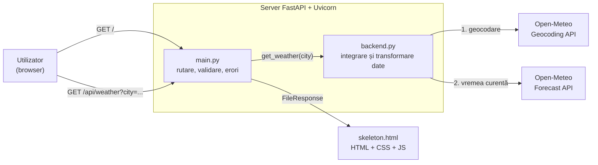
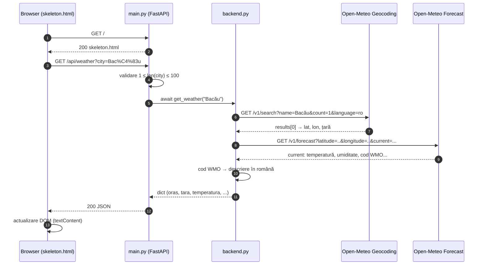

# 🌤️ Vremea Acum — aplicație web meteo


**Vremea Acum** este o aplicație web care afișează, în timp real, starea vremii din orice oraș al lumii. Utilizatorul scrie numele unui oraș, iar aplicația îl localizează geografic, interoghează un model meteorologic numeric și prezintă, în limba română, temperatura, temperatura resimțită, umiditatea, viteza vântului și precipitațiile.

Aplicația este construită cu **FastAPI** (backend asincron în Python), **httpx** (client HTTP asincron) și o interfață **HTML5 / CSS3 / JavaScript** fără dependențe externe. Datele provin de la **[Open-Meteo](https://open-meteo.com/)**, un serviciu meteo deschis care nu necesită cheie API.

---

## Cuprins

1. [Ce problemă rezolvă aplicația](#1-ce-problemă-rezolvă-aplicația)
2. [Funcționalități](#2-funcționalități)
3. [Tehnologii folosite și justificarea alegerii](#3-tehnologii-folosite-și-justificarea-alegerii)
4. [Arhitectura aplicației](#4-arhitectura-aplicației)
5. [Organizarea proiectului](#5-organizarea-proiectului)
6. [Interfața de programare (API)](#6-interfața-de-programare-api)
7. [Ghid de instalare](#7-ghid-de-instalare)
8. [Ghid de utilizare](#8-ghid-de-utilizare)
9. [Limitări cunoscute](#9-limitări-cunoscute)
10. [Dezvoltări viitoare](#10-dezvoltări-viitoare)
11. [Autori](#11-autori)
12. [Licență](#12-licență)
13. [Surse și atribuiri](#13-surse-și-atribuiri)

---

## 1. Ce problemă rezolvă aplicația

Informația meteo este disponibilă pe numeroase site-uri, dar acestea sunt, de regulă, încărcate cu reclame, scripturi de urmărire, prognoze pe 14 zile și hărți, ceea ce face ca răspunsul la o întrebare simplă — *„cum este vremea acum în orașul X?”* — să necesite mai mulți pași și o pagină grea. În plus, API-urile meteo publice returnează date brute (coordonate, coduri numerice WMO, unități în engleză), greu de folosit direct de un utilizator obișnuit.

**Vremea Acum** rezolvă această problemă printr-o interfață minimală, în limba română, care:

- transformă **numele unui oraș** în coordonate geografice (geocodare), fără ca utilizatorul să știe latitudinea sau longitudinea;
- traduce **codurile meteorologice WMO** (de ex. `61`) în descrieri inteligibile (de ex. *„Ploaie slabă”*);
- prezintă doar **parametrii relevanți pentru starea curentă**, într-un card ușor de citit pe telefon sau pe desktop;
- funcționează **fără cont, fără cheie API și fără reclame**.

Din punct de vedere didactic, proiectul ilustrează integrarea unui serviciu web extern într-o aplicație cu arhitectură stratificată: client → API propriu → servicii externe.

---

## 2. Funcționalități

| # | Funcționalitate | Unde este implementată |
|---|---|---|
| F1 | Căutarea vremii după numele orașului (orice limbă, cu sau fără diacritice) | `skeleton.html`, `backend.py` |
| F2 | Geocodare automată: nume oraș → latitudine/longitudine, țară | `backend.py` → Open-Meteo Geocoding API |
| F3 | Afișarea condițiilor curente: temperatură, temperatură resimțită, umiditate relativă, viteza vântului, precipitații | `backend.py` → Open-Meteo Forecast API |
| F4 | Traducerea codurilor meteo WMO în descrieri în limba română (21 de coduri) | dicționarul `DESCRIPTIONS` din `backend.py` |
| F5 | Ora ultimei actualizări, exprimată în fusul orar local al orașului (`timezone=auto`) | `backend.py`, `skeleton.html` |
| F6 | Încărcarea automată a vremii pentru orașul implicit (**Bacău**) la deschiderea paginii | `form.requestSubmit()` în `skeleton.html` |
| F7 | Actualizarea rezultatului fără reîncărcarea paginii (Fetch API / AJAX) | `skeleton.html` |
| F8 | Validarea datelor de intrare pe client (`required`, `maxlength=100`) și pe server (1–100 caractere) | `skeleton.html`, `main.py` |
| F9 | Mesaje de eroare clare în română: oraș inexistent (404), serviciu meteo indisponibil (502) | `main.py` |
| F10 | Endpoint JSON reutilizabil (`/api/weather`) și documentație interactivă generată automat (`/docs`, `/redoc`) | FastAPI |
| F11 | Interfață responsivă și accesibilă (`lang="ro"`, `aria-live`, `role="status"`) | `skeleton.html` |
| F12 | Afișare sigură a datelor (doar prin `textContent`, fără injectare de HTML) | `skeleton.html` |

---

## 3. Tehnologii folosite și justificarea alegerii

| Strat | Tehnologie | Rol | De ce această alegere (comparativ cu alternativele) |
|---|---|---|---|
| Limbaj | **Python 3** (dezvoltat pe 3.13) | Logica serverului | Sintaxă clară, ecosistem bogat pentru web și date; tipurile adnotate (`city: str`) sunt folosite direct de FastAPI pentru validare. |
| Framework web | **FastAPI** | Rutare, validare, serializare JSON, documentație OpenAPI | Față de **Flask**: este nativ asincron (ASGI), validează automat parametrii pe baza tipurilor și generează documentația `/docs` fără cod suplimentar. Față de **Django**: este mult mai ușor — aplicația nu are nevoie de ORM, panou de administrare sau sistem de autentificare. |
| Server | **Uvicorn** | Server ASGI care rulează aplicația | Implementare ASGI de referință pentru FastAPI; suportă `--reload` în dezvoltare. Un server WSGI clasic (de ex. Gunicorn cu workeri sincroni) nu poate rula direct o aplicație ASGI. |
| Client HTTP | **httpx** (`AsyncClient`) | Apeluri către Open-Meteo | Față de **requests**: `requests` este blocant — apelat într-o funcție `async`, ar bloca bucla de evenimente și ar serializa toate cererile. `httpx` oferă o interfață aproape identică cu `requests`, dar și variantă asincronă, cu timeout-uri explicite. Față de **aiohttp**: API mai simplu și aceeași bibliotecă pentru cod sincron și asincron. |
| Sursă de date | **Open-Meteo** (Geocoding + Forecast) | Coordonate și date meteo curente | Față de **OpenWeatherMap** sau **WeatherAPI**: nu necesită cont sau cheie API (nu există secrete de protejat), datele sunt publicate sub licența deschisă **CC BY 4.0**, iar modelul `best_match` combină automat cele mai precise modele numerice pentru fiecare locație. |
| Interfață | **HTML5 + CSS3 + JavaScript (vanilla)** | Formular, afișarea rezultatelor | Față de **React / Vue**: nu este nevoie de Node.js, de pas de build sau de dependențe — întreaga interfață are ~250 de linii într-un singur fișier. Pentru un singur ecran, un framework ar adăuga complexitate fără beneficiu. |
| Randare | **Pagină statică + API JSON** (`FileResponse` + `fetch`) | Separarea prezentării de date | Față de **randarea pe server cu Jinja2** (șabloane `{{ variabila }}`): la fiecare căutare se actualizează doar cardul, nu întreaga pagină, iar endpoint-ul `/api/weather` poate fi refolosit de alți clienți (aplicație mobilă, script). Jinja2 rămâne avantajos când pagina trebuie să funcționeze fără JavaScript sau pentru indexare SEO — vezi [Dezvoltări viitoare](#10-dezvoltări-viitoare). |
| Stilizare | **CSS Grid, Flexbox, gradient** | Aspect modern, responsiv | Fără **Bootstrap / Tailwind**: stilurile necesare sunt puține, iar CSS-ul nativ evită descărcarea unei biblioteci externe. |

---

## 4. Arhitectura aplicației

Aplicația urmează o **arhitectură stratificată pe trei niveluri**, cu responsabilități separate:

1. **Stratul de prezentare** (`skeleton.html`) — interfața din browser: preia orașul, apelează API-ul propriu și afișează rezultatul.
2. **Stratul API** (`main.py`) — definește rutele HTTP, validează parametrii și traduce erorile tehnice în coduri HTTP și mesaje în română.
3. **Stratul de servicii / integrare** (`backend.py`) — comunică cu Open-Meteo și transformă răspunsurile externe (în engleză, cu coduri numerice) într-un obiect simplu, în română. Funcționează ca un **adaptor**: dacă furnizorul de date se schimbă, se modifică doar acest fișier.



### Fluxul unei cereri



Tratarea erorilor: dacă geocodarea nu găsește niciun rezultat, `get_weather` returnează `None`, iar API-ul răspunde cu **404**. Orice eroare de rețea, timeout sau răspuns 4xx/5xx de la Open-Meteo (`httpx.HTTPError`) este transformată în **502**.

---

## 5. Organizarea proiectului

```text
.
├── main.py            # aplicația FastAPI: rutele "/" și "/api/weather", tratarea erorilor
├── backend.py         # integrarea cu Open-Meteo: geocodare, vreme curentă, coduri WMO
├── skeleton.html      # interfața web: HTML, CSS și JavaScript într-un singur fișier
├── requirements.txt   # dependențele Python
├── README.md          # acest fișier
├── LICENSE            # textul licenței GNU GPL v3
└── docs/
    ├── Documentatie_Tehnica_Vremea_Acum.docx
    └── screenshots/   # capturi de ecran folosite în README
```

| Fișier | Componente principale |
|---|---|
| `main.py` | `app = FastAPI(...)`; `HTML_FILE` (cale absolută către `skeleton.html`, calculată cu `Path(__file__).with_name`); `home()` → `GET /`; `weather(city)` → `GET /api/weather` |
| `backend.py` | constantele `GEOCODING_URL`, `WEATHER_URL`; dicționarul `DESCRIPTIONS` (cod WMO → text); funcția asincronă `get_weather(city)` |
| `skeleton.html` | formularul `#weather-form`; secțiunea `#result`; zona de mesaje `#message`; scriptul care apelează `/api/weather` |

> Folderul `__pycache__/` și fișierele `.pyc` sunt generate automat de Python și nu trebuie urcate pe GitHub (adăugați `__pycache__/` și `.venv/` în `.gitignore`).

---

## 6. Interfața de programare (API)

| Metodă | Rută | Parametri | Răspuns |
|---|---|---|---|
| `GET` | `/` | — | Pagina `skeleton.html` |
| `GET` | `/api/weather` | `city` (șir, obligatoriu, 1–100 caractere) | JSON cu vremea curentă |
| `GET` | `/docs` | — | Documentație interactivă Swagger UI (generată de FastAPI) |
| `GET` | `/redoc` | — | Documentație ReDoc (generată de FastAPI) |

**Exemplu de cerere:**

```bash
curl "http://127.0.0.1:8000/api/weather?city=Bac%C4%83u"
```

**Exemplu de răspuns** (valori ilustrative):

```json
{
  "oras": "Bacău",
  "tara": "România",
  "temperatura": 11.4,
  "resimtita": 9.2,
  "umiditate": 78,
  "vant": 9.7,
  "precipitatii": 0.0,
  "descriere": "Parțial noros",
  "zi": true,
  "ora_actualizare": "2026-10-23T09:15"
}
```

| Câmp | Tip | Unitate | Semnificație |
|---|---|---|---|
| `oras` | string | — | Numele localității găsite (localizat în română când este disponibil) |
| `tara` | string | — | Țara (șir gol dacă lipsește) |
| `temperatura` | number | °C | Temperatura aerului la 2 m deasupra solului |
| `resimtita` | number | °C | Temperatura resimțită (vânt, umiditate, radiație solară) |
| `umiditate` | integer | % | Umiditatea relativă la 2 m |
| `vant` | number | km/h | Viteza vântului la 10 m (înălțimea standard) |
| `precipitatii` | number | mm | Precipitațiile din intervalul curent al modelului (de regulă ultimele 15 minute) |
| `descriere` | string | — | Descrierea în română a codului WMO |
| `zi` | boolean | — | `true` dacă la locație este zi |
| `ora_actualizare` | string | ISO 8601 | Momentul datelor, în ora locală a orașului |

**Coduri de stare HTTP:**

| Cod | Situație | Mesaj (`detail`) |
|---|---|---|
| `200` | Succes | — |
| `404` | Orașul nu a fost găsit de serviciul de geocodare | `Orașul nu a fost găsit.` |
| `422` | Parametrul `city` lipsește sau are lungime invalidă | eroare de validare FastAPI |
| `502` | Eroare de rețea, timeout sau eroare la Open-Meteo | `Serviciul meteo nu este disponibil momentan.` |

---

## 7. Ghid de instalare

### Cerințe

- **Python 3.10 sau mai nou** (proiectul a fost dezvoltat pe Python 3.13)
- **pip** și, opțional, **git**
- conexiune la internet (aplicația interoghează Open-Meteo)
- **nu** este necesară nicio cheie API sau fișier `.env`

### Pași

**1. Descărcați proiectul**

```bash
git clone https://github.com/caloiansorin/INFO_ZI_MAP_26_27.git
cd INFO_ZI_MAP_26_27
```

**2. Creați și activați un mediu virtual**

```bash
python -m venv .venv
```

| Sistem | Comandă de activare |
|---|---|
| Linux / macOS | `source .venv/bin/activate` |
| Windows (PowerShell) | `.venv\Scripts\Activate.ps1` |
| Windows (cmd) | `.venv\Scripts\activate.bat` |

**3. Instalați dependențele**

```bash
pip install -r requirements.txt
```

Conținutul fișierului `requirements.txt`:

```text
fastapi>=0.110
uvicorn[standard]>=0.29
httpx>=0.27
```

**4. Porniți serverul**

```bash
uvicorn main:app --reload
```

**5. Deschideți aplicația** în browser la adresa **http://127.0.0.1:8000**.
Documentația API este disponibilă la **http://127.0.0.1:8000/docs**.

> Pentru a accesa aplicația de pe alt dispozitiv din aceeași rețea: `uvicorn main:app --host 0.0.0.0 --port 8000`.
> Opțiunea `--reload` este destinată doar dezvoltării.

---

## 8. Ghid de utilizare

1. **Deschideți aplicația.** La încărcare, se afișează automat vremea pentru orașul implicit, *Bacău*.

   

2. **Introduceți un oraș** în câmpul *„Introdu un oraș...”* (de exemplu `Iași`, `Cluj-Napoca`, `London`, `Tokyo`). Diacriticele sunt opționale: `Iasi` și `Iași` dau același rezultat.

3. **Apăsați „Caută”** sau tasta **Enter**. Pe durata cererii apare mesajul *„Se încarcă vremea...”*.

4. **Citiți rezultatul:** orașul și țara, ora actualizării, temperatura (rotunjită la grad), descrierea vremii și patru indicatori — *Se simte ca*, *Umiditate*, *Viteza vântului*, *Precipitații*.

   

5. **Dacă orașul nu există**, apare mesajul *„Orașul nu a fost găsit.”*; dacă serviciul meteo nu răspunde, apare *„Serviciul meteo nu este disponibil momentan.”*

   

**Sfat:** pentru orașe cu același nume, conform documentației Open-Meteo puteți adăuga țara după virgulă — de exemplu `Paris, FR` sau `Victoria, RO`.

**Utilizare din linia de comandă:** endpoint-ul poate fi apelat direct, de exemplu `curl "http://127.0.0.1:8000/api/weather?city=Iasi"`.

---

## 9. Limitări cunoscute

| # | Limitare | Efect |
|---|---|---|
| L1 | Doar vremea **curentă**, fără prognoză orară sau zilnică | Utilizatorul nu poate vedea cum va fi vremea mai târziu. |
| L2 | Geocodarea folosește **primul rezultat** (`count=1`), iar regiunea (`admin1`) nu este afișată | La orașe cu același nume poate fi ales alt loc decât cel dorit, fără ca utilizatorul să observe. |
| L3 | Dicționarul `DESCRIPTIONS` acoperă **21 din 29** de coduri WMO folosite de Open-Meteo (lipsesc 56, 57, 66, 67, 77, 85, 86, 97) | Pentru burniță/ploaie înghețată, grăunțe de zăpadă, averse de ninsoare și furtună puternică se afișează textul generic *„Condiții meteo variabile”*. |
| L4 | **Fără cache** — fiecare căutare face două cereri externe | Latență mai mare și consum din limitele gratuite Open-Meteo (sub 10 000 de cereri/zi, 5 000/oră, 600/minut, per IP). |
| L5 | Se creează un **`AsyncClient` nou la fiecare cerere** | Conexiunile TCP/TLS nu sunt refolosite între cereri. |
| L6 | Cele două apeluri externe sunt **secvențiale**, cu timeout de 10 s pe fiecare operație | În cel mai rău caz, răspunsul poate dura peste 10 s. |
| L7 | Erorile neprevăzute (de ex. o cheie lipsă în răspunsul Open-Meteo) produc **500** cu text simplu | Interfața încearcă `response.json()` pe un răspuns care nu este JSON și afișează un mesaj tehnic al browserului. |
| L8 | Pentru eroarea **422**, `detail` este o listă de obiecte | Dacă ar ajunge în interfață, ar fi afișat ca `[object Object]` (în practică, validarea din formular previne situația). |
| L9 | Câmpul `precipitatii` reprezintă intervalul curent al modelului (de regulă 15 minute), nu totalul zilei | Valoarea poate fi interpretată greșit ca precipitații zilnice. |
| L10 | Ora afișată este **ora locală a orașului**, nu a utilizatorului | Pentru orașe din alt fus orar, eticheta „Actualizat” poate crea confuzie. |
| L11 | Unități fixe (°C, km/h), interfață doar în română, oraș implicit fix (Bacău) | Fără personalizare. |
| L12 | Câmpul `zi` este returnat, dar **nu este folosit** de interfață | Nu există temă zi/noapte sau pictograme. |
| L13 | Planul gratuit Open-Meteo este destinat **exclusiv uzului necomercial** | O versiune comercială ar necesita un abonament Open-Meteo. |
| L14 | Lipsesc testele automate, jurnalizarea (logging) și configurarea pentru producție (Docker, HTTPS) | Calitatea se verifică doar manual. |

---

## 10. Dezvoltări viitoare

- **Prognoză** orară și pe 7 zile (parametrii `hourly` și `daily` din Open-Meteo), cu grafic de temperatură.
- **Sugestii la tastare (autocomplete):** `count=5` la geocodare și afișarea regiunii și țării pentru alegerea corectă a orașului.
- **Geolocalizare** din browser (`navigator.geolocation`) pentru vremea locației curente.
- **Cache** în memorie cu durată de viață de 10–15 minute (sau Redis) pentru a reduce latența și numărul de cereri externe.
- **Client HTTP partajat**, creat o singură dată la pornire prin `lifespan` în FastAPI.
- **Completarea codurilor WMO**, pictograme meteo și temă zi/noapte pe baza câmpului `zi`.
- **Model de răspuns Pydantic** (`response_model`) pentru o schemă documentată în OpenAPI.
- Mesaje de eroare robuste în interfață (verificarea `Content-Type` înainte de `response.json()`).
- **Comutare de unități** (°C/°F, km/h/m/s) și **interfață multilingvă**.
- **Randare pe server cu Jinja2** ca variantă de rezervă pentru browsere fără JavaScript (*progressive enhancement*).
- **Calitatea aerului și indice UV** prin Open-Meteo Air Quality API.
- **Teste automate** cu `pytest` și `httpx.MockTransport`, integrare continuă cu GitHub Actions, imagine **Docker**.
- Aplicație instalabilă (**PWA**) cu ultimele date salvate pentru acces offline.

---

## 11. Autori

| Nume | Rol |
|---|---|
| **Sandu Yanis** | Autor — proiectare, implementare, documentație |

---

## 12. Licență

Acest proiect este distribuit sub licența **GNU General Public License v3.0** (GPL-3.0-or-later).

Aveți dreptul să folosiți, să studiați, să modificați și să redistribuiți codul, cu condiția ca orice versiune distribuită (modificată sau nu) să fie publicată sub aceeași licență, împreună cu codul sursă. Textul complet se află în fișierul [`LICENSE`](LICENSE) și la <https://www.gnu.org/licenses/gpl-3.0.html>.

```text
Vremea Acum — aplicație web meteo
Copyright (C) 2026 Sandu Yanis

This program is free software: you can redistribute it and/or modify
it under the terms of the GNU General Public License as published by
the Free Software Foundation, either version 3 of the License, or
(at your option) any later version.

This program is distributed in the hope that it will be useful,
but WITHOUT ANY WARRANTY; without even the implied warranty of
MERCHANTABILITY or FITNESS FOR A PARTICULAR PURPOSE. See the
GNU General Public License for more details.
```

> Pe GitHub, fișierul `LICENSE` se poate adăuga din **Add file → Create new file**, cu numele `LICENSE`, apoi **Choose a license template → GNU General Public License v3.0**.

---

## 13. Surse și atribuiri

- Date meteo: [Open-Meteo.com](https://open-meteo.com/), licență [CC BY 4.0](https://creativecommons.org/licenses/by/4.0/). Atribuirea este afișată în subsolul aplicației.
- Date de geocodare: Open-Meteo Geocoding API, bazat pe [GeoNames](https://www.geonames.org/).
- [Documentația FastAPI](https://fastapi.tiangolo.com/) · [Documentația httpx](https://www.python-httpx.org/) · [Documentația Uvicorn](https://www.uvicorn.org/)
- [Open-Meteo Forecast API](https://open-meteo.com/en/docs) · [Open-Meteo Geocoding API](https://open-meteo.com/en/docs/geocoding-api) · [Termenii Open-Meteo](https://open-meteo.com/en/terms)
